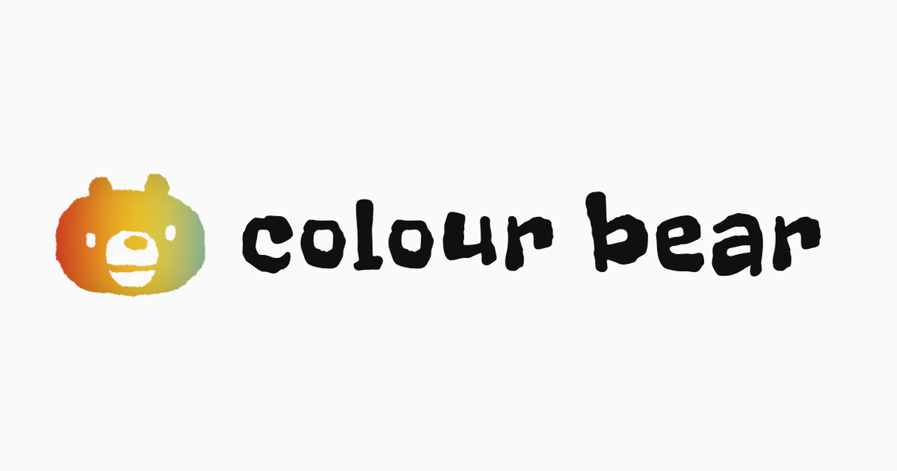

Generate UI-ready colour palettes from any image.

Drop in an image and Colour Bear pulls a palette from it. Mix or pick colours straight from the image, generate Tailwind shades, then export as CSS or Tailwind.

Built with React, Vite and Tailwind. Fonts are Poppins and Freckle Face (OFL).
